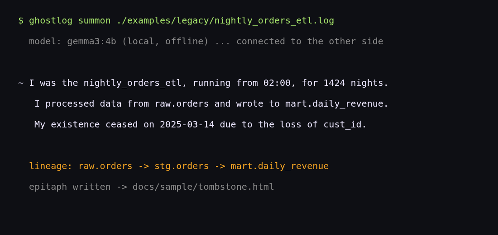
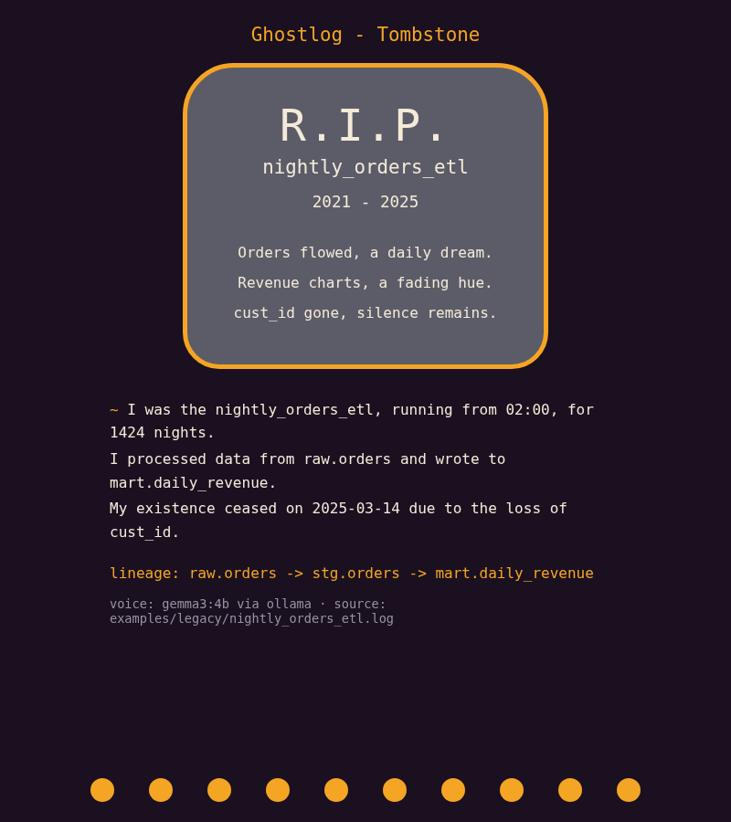

# Ghostlog

**A local séance for dead data pipelines.**

Point Ghostlog at the remains of a retired job (an old cron or Airflow log, or a
deprecated `.sql` file) and it summons the job's ghost. Ghostlog reads the
remains, rebuilds the job's table lineage with [sqlglot](https://github.com/tobymao/sqlglot),
and asks [Gemma](https://ai.google.dev/gemma), running locally through
[Ollama](https://ollama.com), to let the job speak for itself in the first person.
Then it carves an ofrenda-style tombstone page you can open in any browser.

Everything runs on your own machine. Your logs and SQL stay on your laptop, and
it keeps working with the Wi-Fi off.

Built for the DEV Hacktoberfest Open-Source AI Challenge, Week 4: *Ghost in the Machine*.





## Quick start

```bash
git clone https://github.com/nightmoose/ghostlog
cd ghostlog
python -m venv .venv && . .venv/bin/activate
pip install -e .

# optional, for the ghost's own voice:
ollama pull gemma3:4b

ghostlog summon examples/legacy/nightly_orders_etl.log
# then open tombstone.html
```

Without Ollama, Ghostlog still completes the séance. It tells you why it fell
back and speaks through a deterministic template built from the same facts:

```text
  model: gemma3:4b unreachable ... speaking through the offline template

~ I was nightly_orders_etl. I ran at 02:00 for 1,424 nights.
   I read raw.orders and wrote mart.daily_revenue.
   I died on 2025-03-14: upstream column 'cust_id' vanished.

  lineage: raw.orders -> stg.orders -> mart.daily_revenue
  epitaph written -> tombstone.html
```

## Commands

| Command | What it does |
|---|---|
| `ghostlog summon PATH` | Read a log or `.sql` file, channel the ghost, write `tombstone.html` |
| `ghostlog summon PATH --offline` | Skip the model and use the template voice |
| `ghostlog summon PATH --model gemma3:1b` | Use any Ollama model tag (default `gemma3:4b`, or `$GHOSTLOG_MODEL`) |
| `ghostlog summon PATH --host URL` | Use a different Ollama server (default `$OLLAMA_HOST` or `http://127.0.0.1:11434`) |
| `ghostlog summon PATH --dialect bigquery` | Pass a sqlglot dialect for parsing |
| `ghostlog lineage PATH` | Print only the table lineage edges |

## How it works

```
log / .sql ──► logparse  ──► facts (name, nights run, start time, death date, cause)
                  │
                  └─ SQL ──► sqlglot lineage ──► raw.orders -> stg.orders -> mart.daily_revenue
                                     │
        facts + lineage (JSON) ──────┴──► Gemma via Ollama ──► testimony + epitaph
                                                   │
                                  grounding check ─┴─► tombstone.html (self-contained)
```

1. **The remains (`ghostlog/logparse.py`).** A line-by-line parser that pulls
   the job name, the nights it ran, its usual start time, every distinct SQL
   statement, and the last error. Errors become a plain cause of death, for
   example `column "cust_id" does not exist` becomes "upstream column 'cust_id' vanished".
2. **The lineage (`ghostlog/lineage.py`).** sqlglot parses each `INSERT`,
   `CREATE TABLE AS`, `MERGE`, or `UPDATE`, and Ghostlog records a
   source-to-target edge for every table it reads, ignoring CTE names.
   Statements that fail to parse are kept and reported, not fatal.
3. **The medium (`ghostlog/medium.py`).** The facts go to Gemma as JSON, with
   an Ollama JSON-schema `format` so the reply is always a 3-line testimony
   and a 3-line epitaph. The facts are computed by code; the model only
   supplies the voice.
4. **The grounding check.** Ghostlog only uses the model's reply if the ghost
   names its own job and every number it says (dates, counts, times)
   appears in the facts. Otherwise it explains why and uses the template, so a
   small model cannot invent "fourteen nights" on your tombstone.
5. **The tombstone (`ghostlog/tombstone.py`).** One HTML file with inline CSS,
   no scripts, and no external requests. Every value is HTML-escaped.

## Real sample output

These files were produced on a CPU-only Linux machine with `gemma3:4b` through
Ollama 0.40 and are committed as-is:

- [`docs/sample/summon-output.txt`](docs/sample/summon-output.txt) and
  [`docs/sample/tombstone.html`](docs/sample/tombstone.html): the nightly ETL log, voiced by Gemma
- [`docs/sample/churn-output.txt`](docs/sample/churn-output.txt) and
  [`docs/sample/churn_tombstone.html`](docs/sample/churn_tombstone.html): a deprecated SQL file with a CTE
- [`docs/sample/summon-offline-output.txt`](docs/sample/summon-offline-output.txt): the same log with `--offline`

The example log in `examples/legacy/` is synthetic. `tools/make_example_log.py`
regenerates it.

## Tests

```bash
pip install -e '.[dev]'
pytest -v
ruff check . && ruff format --check .
```

The test suite runs fully offline. A fixture makes any real HTTP call fail the
test, and the model is exercised through fakes: valid, malformed, ungrounded,
and unreachable replies. CI runs on Python 3.10, 3.12, and 3.13, plus a CLI
smoke test with no model installed.

## Dependencies and licenses

Ghostlog itself is MIT. It has one runtime Python dependency.

| Package | Used for | License | Source |
|---|---|---|---|
| sqlglot | SQL parsing and lineage (runtime) | MIT | [LICENSE](https://github.com/tobymao/sqlglot/blob/main/LICENSE) |
| pytest | tests (dev) | MIT | [LICENSE](https://github.com/pytest-dev/pytest/blob/main/LICENSE) |
| pluggy | pytest dependency (dev) | MIT | [LICENSE](https://github.com/pytest-dev/pluggy/blob/main/LICENSE) |
| iniconfig | pytest dependency (dev) | MIT | [LICENSE](https://github.com/pytest-dev/iniconfig/blob/main/LICENSE) |
| packaging | pytest dependency (dev) | Apache-2.0 OR BSD-2-Clause (dual) | [LICENSE](https://github.com/pypa/packaging/blob/main/LICENSE) |
| Pygments | pytest dependency (dev) | BSD-2-Clause | [LICENSE](https://github.com/pygments/pygments/blob/master/LICENSE) |
| ruff | lint and format (dev) | MIT | [LICENSE](https://github.com/astral-sh/ruff/blob/main/LICENSE) |

The Ollama client is plain `urllib` from the standard library, so no extra
package is needed. Optional external pieces you install yourself:

| Piece | Role | License |
|---|---|---|
| [Ollama](https://github.com/ollama/ollama) | local model server | MIT |
| [Gemma](https://ai.google.dev/gemma) weights | the ghost's voice | [Gemma Terms of Use](https://ai.google.dev/gemma/terms) (open weights, not an OSI license) |

## Project status

Ghostlog was started and built on October 31, 2026, during the challenge window.
Any commits made after the challenge deadline (Oct 31, 2026, 11:59 PM PDT) will
be listed here.

## License

[MIT](LICENSE)
